<p align="center">
  <a href="https://github.com/Dawnilove/JetDeck/releases/latest"></a>
</p>

<h3 align="center">젯슨 하나 다루는데 창 다섯 개 띄우지 마세요.</h3>

<p align="center">
  터미널 · 원격 편집 · 시스템 모니터 · <b>ROS2 도구</b> · 파일 전송 · 포트 포워딩 · <b>시리얼 콘솔</b> · Claude 연결<br>
  <b>NVIDIA Jetson</b>을 위해 만든 SSH 작업 공간. 젯슨에는 아무것도 설치하지 않아요.
</p>

<p align="center">
  <a href="https://github.com/Dawnilove/JetDeck/releases/latest"></a>
  
  
</p>

<p align="center">
  <a href="https://github.com/Dawnilove/JetDeck/releases/latest"><b>⬇ 내려받기</b></a> &nbsp;·&nbsp;
  <a href="#-3분-시작">3분 시작</a> &nbsp;·&nbsp;
  <a href="#-테마">테마</a> &nbsp;·&nbsp;
  <a href="docs/releases/v2.0.0.md">2.0 새 기능</a> &nbsp;·&nbsp;
  <a href="docs/releases/">릴리스 노트</a> &nbsp;·&nbsp;
  <a href="https://github.com/Dawnilove/JetDeck/issues">버그 신고</a>
</p>

---

## 왜 JetDeck?

젯슨 작업은 보통 이렇게 흩어져 있어요.

| 하고 싶은 일 | 보통은 | JetDeck |
|---|---|---|
| 명령 실행 | PuTTY · Windows 터미널 | ✅ 탭·분할 터미널 |
| 코드 편집 | VS Code 원격 (젯슨에 서버 설치) | ✅ 탐색기 + 편집기, **젯슨에 설치 없음** |
| 상태 확인 | `jtop` 설치, `tegrastats` 해석 | ✅ CPU 코어·GPU·온도·전력을 그래프로 |
| 파일 주고받기 | WinSCP · `scp` | ✅ 끌어다 놓기 |
| Jupyter·대시보드 보기 | `ssh -L 8888:…` 외우기 | ✅ 버튼 한 번 포트 포워딩 |
| ROS2 토픽 확인 | `ros2 topic hz …` 반복 입력 | ✅ 목록에서 골라 실시간 Hz |
| 네트워크가 죽었을 때 | PuTTY 시리얼 설정 | ✅ 포트 고르고 연결 |

**전부 한 창에서, SSH만으로.** 젯슨에는 SSH 서버 말고 아무것도 깔지 않아요.

<p align="center">
  
</p>

## ✨ 주요 기능

<table>
  <tr>
    <td width="33%" valign="top">
      <h4>⌨️ 터미널</h4>
      여러 탭·화면 분할·터미널만 크게. 자주 쓰는 명령은 버튼으로. 끊기면 <b>자동 재연결</b>하고 탭은 그대로.
    </td>
    <td width="33%" valign="top">
      <h4>📝 원격 편집</h4>
      VS Code와 같은 Monaco 편집기. <code>Ctrl+P</code>로 파일 찾기, <code>Ctrl+S</code> 저장. 젯슨에서 바뀐 파일은 덮어쓰기 전에 알려 줘요.
    </td>
    <td width="33%" valign="top">
      <h4>📊 시스템 모니터</h4>
      <code>tegrastats</code> 기반 코어별 CPU·GPU·메모리·온도·전력. <b>전원 모드</b> 전환, 절전·재부팅, Wake-on-LAN 깨우기.
    </td>
  </tr>
  <tr>
    <td valign="top">
      <h4>🤖 ROS2 도구 <sup>NEW</sup></h4>
      토픽·노드 목록과 info, <b>echo·hz 실시간</b>, launch 파일 찾아 바로 실행.
    </td>
    <td valign="top">
      <h4>🔧 시리얼 콘솔 <sup>NEW</sup></h4>
      SSH가 안 될 때의 비상구. 포트(<code>COM3</code>, <code>/dev/ttyUSB0</code>)와 속도만 고르면 끝.
    </td>
    <td valign="top">
      <h4>🎨 테마 17종 <sup>NEW</sup></h4>
      에센셜·컬러 무드·네온 사인·마스코트. 모든 글자 대비 4.5:1 이상.
    </td>
  </tr>
  <tr>
    <td valign="top">
      <h4>📁 파일 전송</h4>
      내 PC ↔ 젯슨 양쪽 목록, 끌어다 놓기, 진행률·속도, 전송 취소.
    </td>
    <td valign="top">
      <h4>🔀 포트 포워딩</h4>
      로컬·원격·동적(SOCKS5). Jupyter·TensorBoard 프리셋, 접속하면 자동 시작.
    </td>
    <td valign="top">
      <h4>✳️ Claude 연결 (MCP)</h4>
      Claude가 젯슨에서 명령 실행·파일 편집·상태 확인. 위험한 명령은 <b>내가 허용해야</b> 실행.
    </td>
  </tr>
</table>

<table>
  <tr>
    <td width="50%"><br><sub><b>연결 관리</b> · 호스트 저장, 온라인 표시, 주변 Jetson 자동 찾기</sub></td>
    <td width="50%"><br><sub><b>파일 전송</b> · 양쪽 목록, 끌어다 놓기, 전송 대기열</sub></td>
  </tr>
  <tr>
    <td width="50%"><br><sub><b>포트 포워딩</b> · 자주 쓰는 포트 한 번에</sub></td>
    <td width="50%"><br><sub><b>시리얼 콘솔</b> · 포트와 속도만 고르면 끝</sub></td>
  </tr>
</table>

## 📦 설치

### Windows 10 / 11

1. [최신 릴리스](https://github.com/Dawnilove/JetDeck/releases/latest)에서 **`JetDeck-Setup-x.y.z.exe`** 를 받아 실행 (설치 없이 쓰려면 `-portable.exe`)
2. **"Windows의 PC 보호"** 창이 뜨면 **추가 정보 → 실행** — 아직 코드 서명 인증서가 없어서 생기는 안내예요
3. 끝. 새 버전이 나오면 앱이 알아서 받아 두고 알려 줘요

### Linux (x64)

```bash
chmod +x JetDeck-x.y.z-x86_64.AppImage && ./JetDeck-x.y.z-x86_64.AppImage
```

- 안 열리면 FUSE 2 설치: `sudo apt install libfuse2` (Ubuntu 24.04는 `libfuse2t64`)
- 비밀번호 저장에는 **키링**(GNOME Keyring 등)이 필요해요. 키링이 없으면 비밀번호를 저장하지 않으니 SSH 키를 쓰세요

> **젯슨 쪽 준비물**: SSH 서버만 켜져 있으면 돼요 (JetPack 기본 설치 그대로 OK).

## 🚀 3분 시작

1. **새 연결**에 젯슨 IP·사용자 이름·비밀번호 → **저장 후 연결**
   - USB 케이블로 직접 연결했다면 `192.168.55.1`
   - IP를 모르면 오른쪽 **주변 Jetson 찾기** 🔄
2. 처음 접속 때 뜨는 **호스트 키 확인** → 지문을 보고 **신뢰하고 연결**
3. 왼쪽에서 파일 열기 · 아래에서 명령 실행 · 오른쪽에서 상태 확인. 모든 기능은 <kbd>Ctrl</kbd>+<kbd>Shift</kbd>+<kbd>P</kbd>

처음 실행하면 사용 가이드가 함께 열려요.

### 🤖 ROS2 도구

왼쪽 활동 바의 **ROS2** 버튼. 젯슨의 `ros2` 명령을 SSH로 실행해 보여 줘요. (아래는 화면 구성 예시)

```text
토픽 3   노드 2   launch
────────────────────────────────────────────
/chatter            std_msgs/msg/String        ▶ 주기 측정 (hz)
/parameter_events   rcl_interfaces/msg/…              2.00 Hz 평균
/rosout             rcl_interfaces/msg/Log
```

- **토픽** — 발행·구독 노드, **메시지 보기(echo)**, **주기 측정(hz)**. 멈추거나 화면을 닫으면 젯슨 쪽 명령도 끝나요
- **노드** — 연결된 토픽·서비스
- **launch** — 내 워크스페이스와 설치된 패키지의 launch 파일을 찾아, 확인 후 새 터미널 탭에서 `ros2 launch`

> ROS 환경은 젯슨 `~/.bashrc`의 `source /opt/ros/<배포판>/setup.bash`를 따라요.

### 🔧 시리얼 콘솔

네트워크 설정이 꼬였을 때 젯슨을 살리는 통로예요.

1. 젯슨 USB(장치 모드)를 PC에 꽂거나, USB-TTL 어댑터를 디버그 UART에 연결
2. **새 연결 → 시리얼**에서 포트와 속도(젯슨 기본 **115200**) → **저장 후 연결**
3. 케이블이 빠졌다 다시 꽂히면 자동으로 다시 연결해요

> Linux에서 "접근 권한이 없어요"가 뜨면 `sudo usermod -aG dialout $USER` 후 다시 로그인.

## 🎨 테마

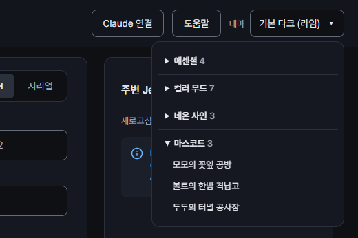

연결 관리 화면 오른쪽 위 **테마** 메뉴에서 바로 바뀌어요. 다시 시작할 필요 없어요.

- **에센셜** — 매일 쓰는 기본 4종
- **컬러 무드** — 노을·숲·바다·종이·레트로 등 분위기 7종
- **네온 사인** — 그라데이션 배경과 유리 패널, *연결 중일 때만* 창 테두리가 빛나요
- **마스코트** — 모모·볼트·두두가 연결 상태에 따라 표정을 바꾸고 한마디씩 해요

모든 테마는 글자·터미널 색 대비 **4.5:1 이상**, 터미널과 편집기는 항상 불투명해요.

<br clear="right">

<table>
  <tr>
    <td><br><sub><b>모모의 꽃잎 공방</b> · 꽃 안테나를 단 꼬마 정비 로봇</sub></td>
    <td>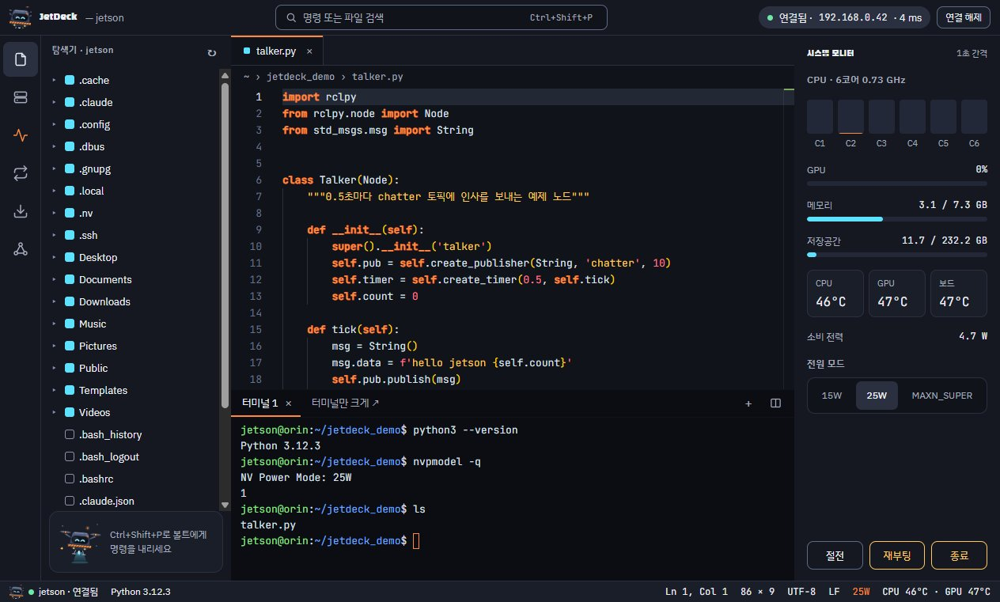<br><sub><b>볼트의 한밤 격납고</b> · 출격 대기 중인 정찰 드론</sub></td>
    <td>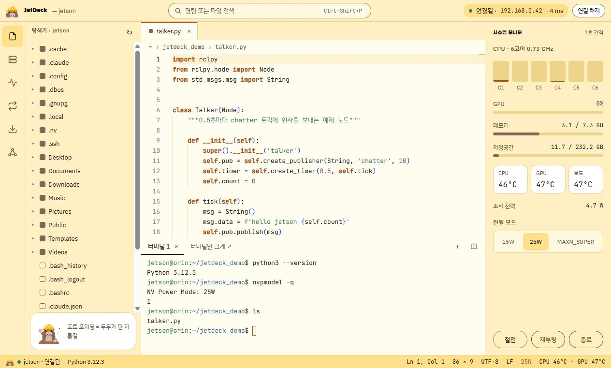<br><sub><b>두두의 터널 공사장</b> · SSH 터널을 파는 두더지</sub></td>
  </tr>
  <tr>
    <td><br><sub>네온 시안</sub></td>
    <td>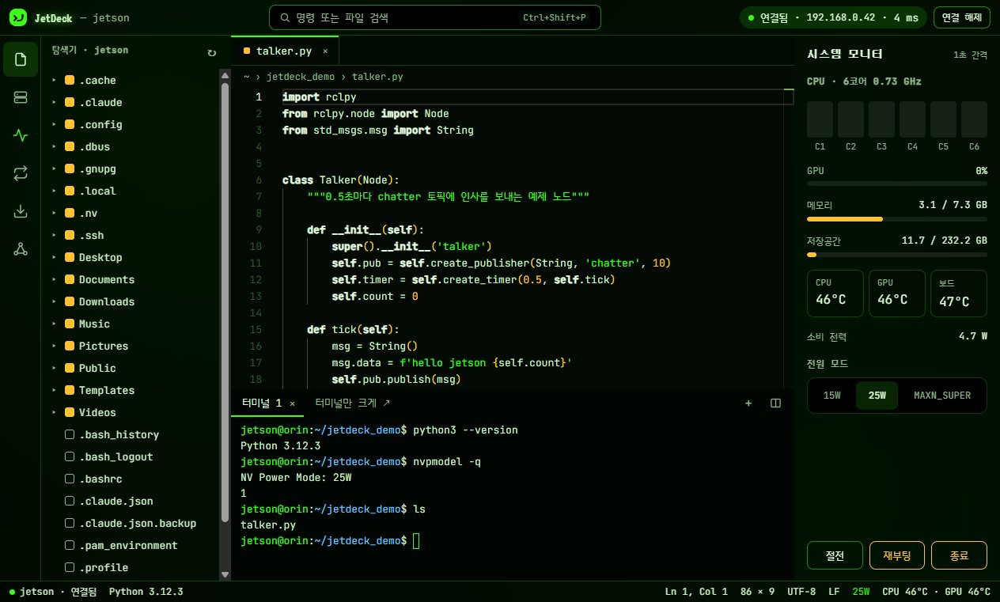<br><sub>네온 그린</sub></td>
    <td>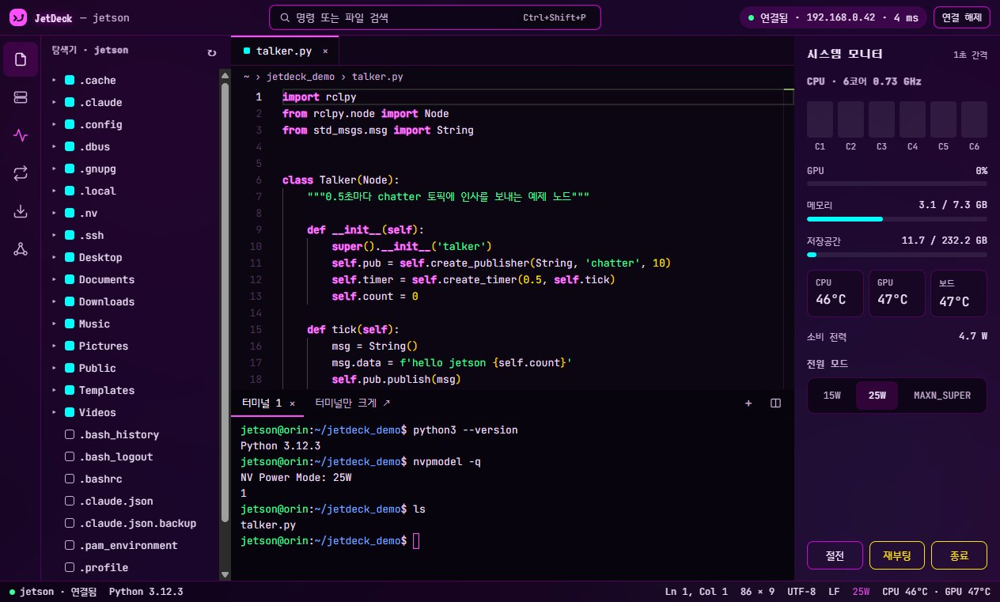<br><sub>네온 마젠타</sub></td>
  </tr>
</table>

<details>
<summary><b>나머지 11종 보기</b> (에센셜 4 · 컬러 무드 7)</summary>
<br>
<table>
  <tr>
    <td>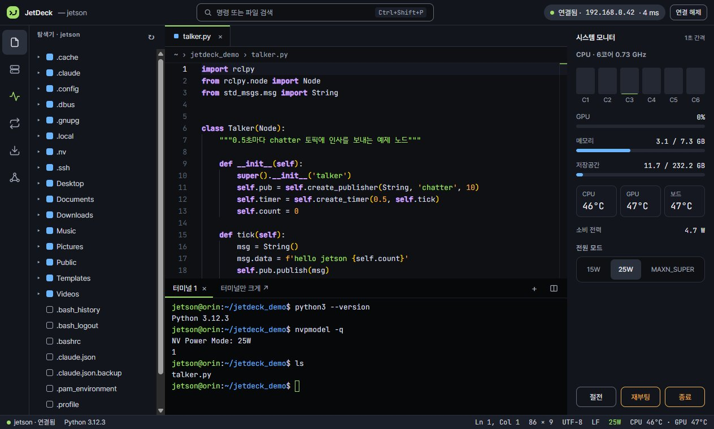<br><sub>기본 다크 (라임)</sub></td>
    <td>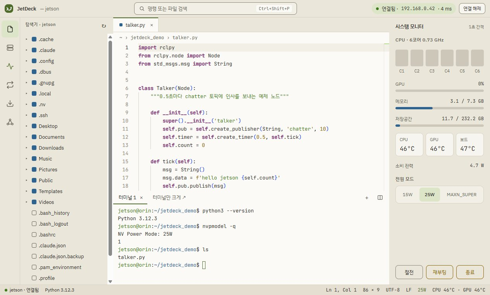<br><sub>라이트 (베이지 · 올리브)</sub></td>
    <td>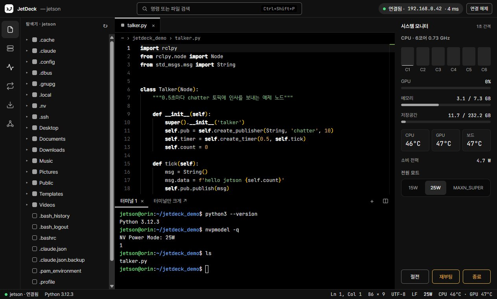<br><sub>다크 (모노 블랙)</sub></td>
  </tr>
  <tr>
    <td>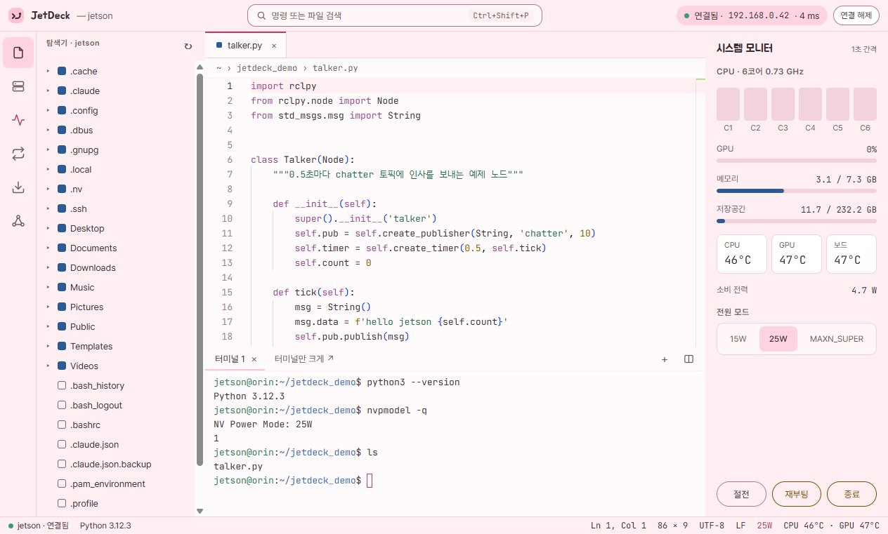<br><sub>솜사탕 (파스텔)</sub></td>
    <td>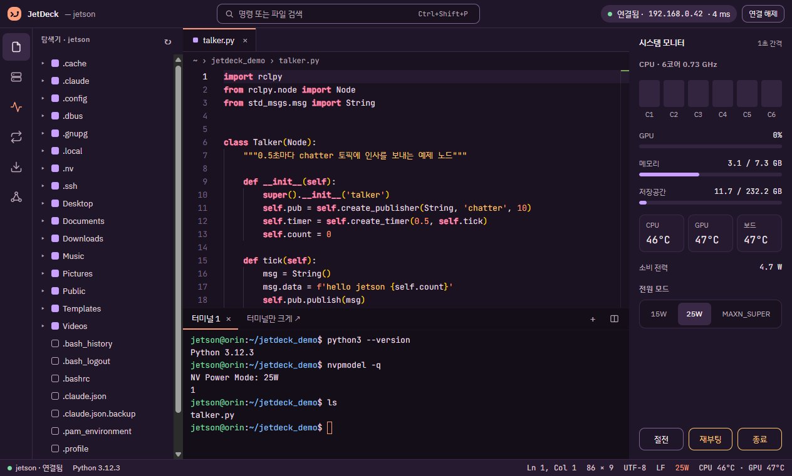<br><sub>노을 (코랄 · 보라)</sub></td>
    <td>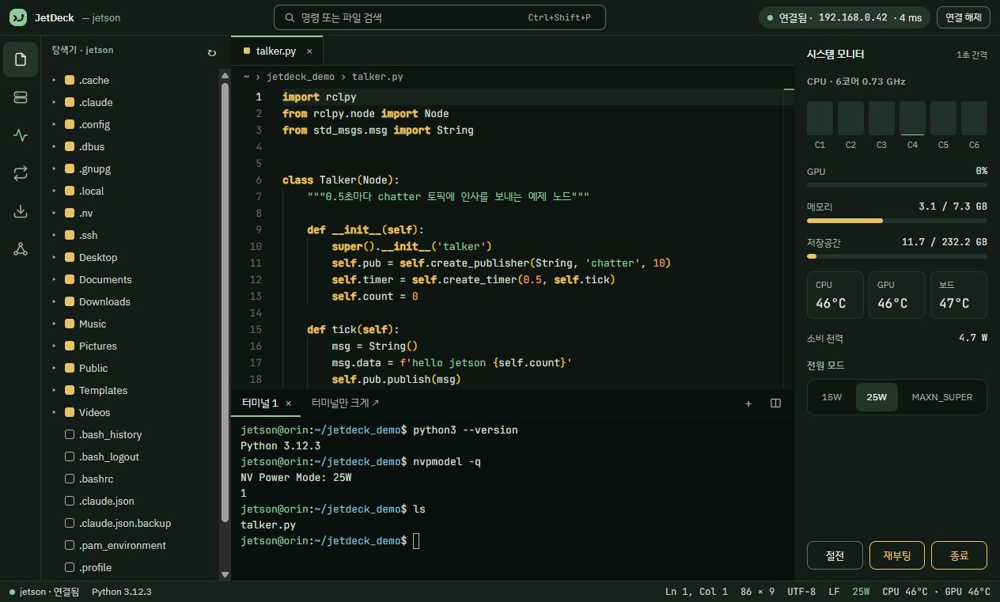<br><sub>숲 (세이지 그린)</sub></td>
  </tr>
  <tr>
    <td>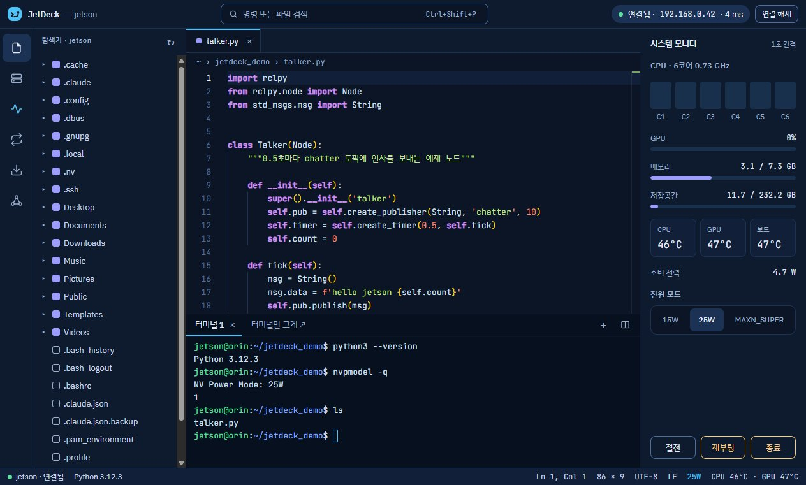<br><sub>딥 오션 (하늘색)</sub></td>
    <td><br><sub>종이 (세피아)</sub></td>
    <td>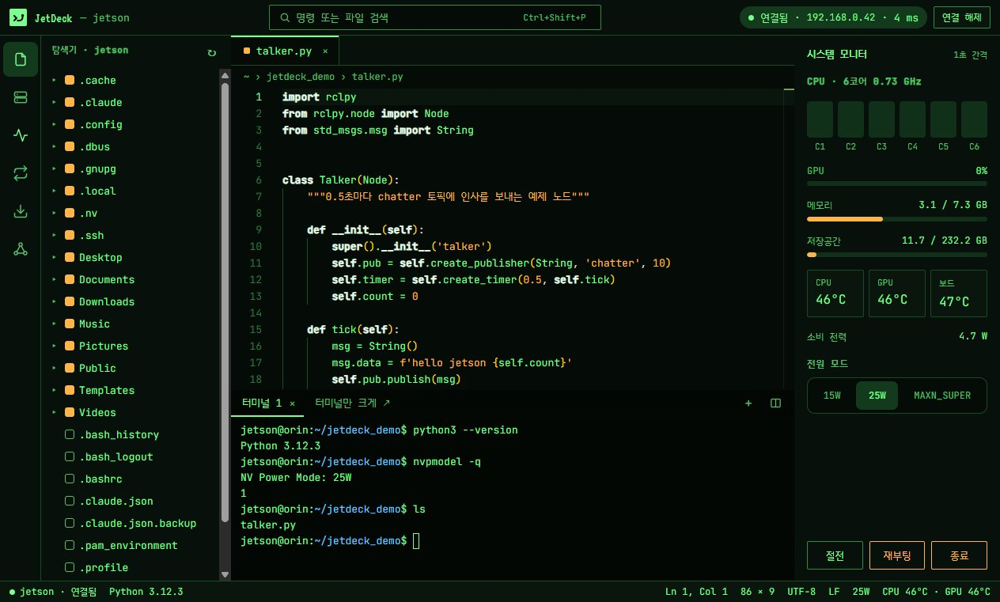<br><sub>레트로 터미널 (CRT 그린)</sub></td>
  </tr>
  <tr>
    <td>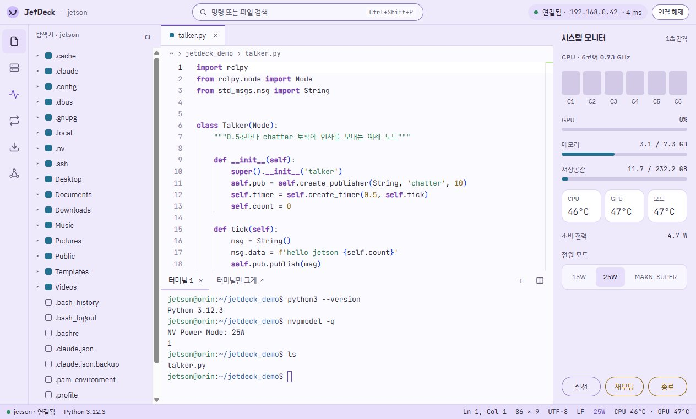<br><sub>라벤더 (연보라)</sub></td>
    <td>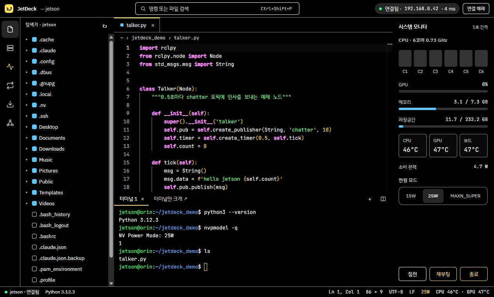<br><sub>고대비 (검정 · 노랑)</sub></td>
    <td></td>
  </tr>
</table>
</details>

<details>
<summary><b>나만의 테마 만들기</b></summary>
<br>

테마 폴더에 JSON 파일을 넣고 앱을 다시 켜면 메뉴에 추가돼요. 같은 `id`면 기본 테마를 덮어써요.

- Windows: `%APPDATA%\nanoterm\themes\`
- Linux: `~/.config/nanoterm/themes/`

기본 테마와 같은 형식(`id`, `label`, `kind`, `ui`, `status`, `terminal.theme`, `editor`, `font`)을 따르면 돼요. 네온 효과(`ui.backgroundCss`, `effects`)와 마스코트(`mascot`)도 같은 방식으로 정의해요.
</details>

## ✳️ Claude에 연결하기 (MCP)

Claude에게 "젯슨 온도 확인해 줘", "~/ros2_ws 빌드하고 오류 고쳐 줘"처럼 말하면 JetDeck을 통해 젯슨에서 바로 실행해요.

1. 연결 관리 화면 위쪽 **Claude 연결** 버튼
2. **Claude Desktop**: 보여 주는 JSON을 `claude_desktop_config.json`에 붙여 넣고 다시 켜기 · **Claude Code**: 보여 주는 `claude mcp add …` 명령을 한 번 실행
3. "orin에 연결해서 GPU 온도 알려 줘"

| 도구 | 하는 일 |
|---|---|
| `list_hosts` · `connect` | 저장된 젯슨 목록·연결 (JetDeck에 탭이 열림) |
| `run_command` | 명령 실행 후 출력·종료 코드 |
| `read_file` · `write_file` · `list_dir` | 파일 읽기·쓰기, 폴더 목록 |
| `get_status` | CPU·GPU·메모리·온도·전력·전원 모드·ROS 버전 |

> 🛡️ `rm`·`sudo`·`reboot`·`kill`·`dd`·`apt`·`systemctl`, `>`로 덮어쓰기 같은 명령은 JetDeck 화면에서 **허용**을 눌러야 실행돼요.
> JetDeck은 이 PC 안(127.0.0.1)에서 비밀 토큰을 가진 요청만 받아요.

## ⌨️ 단축키

| 키 | 동작 |
|---|---|
| <kbd>Ctrl</kbd>+<kbd>Shift</kbd>+<kbd>P</kbd> | 명령 팔레트 (모든 기능) |
| <kbd>Ctrl</kbd>+<kbd>P</kbd> | 파일 이름으로 열기 |
| <kbd>Ctrl</kbd>+<kbd>S</kbd> | 저장 |
| <kbd>Ctrl</kbd>+<kbd>`</kbd> | 터미널 패널 접기/펴기 |
| <kbd>Ctrl</kbd>+<kbd>Shift</kbd>+<kbd>`</kbd> | 새 터미널 |
| <kbd>Ctrl</kbd>+<kbd>C</kbd> / <kbd>V</kbd> (터미널) | 선택이 있으면 복사, 없으면 중단(^C) / 붙여넣기 |
| <kbd>Esc</kbd> | ROS2·파일 전송·포워딩 화면 닫기 |

## 🔒 데이터와 보안

- **비밀번호**는 OS 암호화로 이 PC에만 (Windows: DPAPI, Linux: 키링). 다른 PC로 복사해도 못 풀어요
- **호스트 키**는 처음 접속 때 확인하고, 바뀌면 경고해요. `~/.ssh/known_hosts`도 함께 읽어요 (쓰지 않음)
- **저장 위치**: Windows `%APPDATA%\nanoterm\`, Linux `~/.config/nanoterm/`
- 앱이 밖으로 보내는 건 **젯슨과의 SSH 연결**과 **업데이트 확인(GitHub Releases)** 뿐이에요

## 🩺 문제 해결

<details>
<summary>펼쳐 보기</summary>
<br>

| 증상 | 확인할 것 |
|---|---|
| "응답이 없어요" | 젯슨 전원·네트워크, 같은 공유기인지, IP가 바뀌지 않았는지 |
| "인증 실패" | 사용자 이름·비밀번호. 키 인증이면 키 파일 경로 |
| "비밀번호 로그인을 막아 두었어요" | 그 기기는 SSH 키로만 접속돼요. ① 등록된 키가 있으면 인증 방식을 "SSH 키"로 ② 없으면 `ssh-keygen -t ed25519`로 만든 뒤 `id_ed25519.pub`를 젯슨 `~/.ssh/authorized_keys`에 추가 ③ 본인 젯슨이면 `/etc/ssh/sshd_config.d/`의 `PasswordAuthentication no`를 `yes`로 바꾸고 `sudo systemctl restart ssh`. 앱도 같은 안내를 보여 줘요 |
| 암호 걸린 SSH 키 | `ssh-add`로 ssh-agent에 등록한 뒤 연결 |
| ROS2 목록이 비어 있음 | 노드가 실행 중인지, `~/.bashrc`에 ROS `setup.bash`를 source하는 줄이 있는지 |
| 시리얼 "다른 프로그램이 쓰고 있어요" | PuTTY·Arduino IDE가 같은 포트를 열고 있는지 |
| 시리얼 글자가 깨짐 | 속도(baud). 젯슨 디버그 콘솔은 115200 |
| 시스템 모니터가 비어 있음 | 젯슨이 아니거나 `tegrastats`가 없는 기기 |
| 파일이 편집기로 안 열림 | 5MB 초과, 바이너리, UTF-8이 아닌 파일은 열지 않아요 (원본 보호) |

그래도 안 되면 [Issues](https://github.com/Dawnilove/JetDeck/issues)에 증상과 앱 버전(연결 관리 화면 왼쪽 위 `vX.Y.Z`)을 적어 주세요.
</details>

## 🗺️ 앞으로

| 버전 | 계획 |
|---|---|
| 2.1 | 라즈베리파이·우분투 등 일반 리눅스 모니터 · JetPack/CUDA 버전 표시 · SSH 키 마법사 · 젯슨용 arm64판 |
| 2.2 – 2.4 | 폴더 전송·스니펫 · ROS2 bag·파라미터·서비스 · VNC·RDP 바로 열기 |
| 2.5 – 2.8 | Docker 패널 · 모니터 기록·프로세스 관리 · 여러 기기 대시보드 · 카메라 미리보기 |
| 3.0 | X11 화면 전달 (rviz·rqt) |

## 📄 라이선스

Copyright © 2026 Dawnilove. All rights reserved.
개인·교육 목적으로 무료로 사용할 수 있으며, 설치 파일의 수정·재배포·역설계는 허용하지 않습니다. 소스 코드는 공개하지 않습니다.
