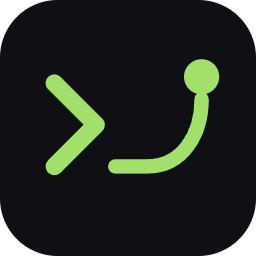

  

<h1 align="center">JetDeck</h1>

  NVIDIA Jetson을 위한 Windows용 SSH 작업 공간 
  터미널 · 원격 파일 편집 · 시스템 모니터 · 파일 전송 · 포트 포워딩을 한 창에서

  <a href="https://github.com/Dawnilove/JetDeck/releases/latest"><b>최신 버전 내려받기</b></a> ·
  <a href="docs/releases/">릴리스 노트</a> ·
  <a href="https://github.com/Dawnilove/JetDeck/issues">버그 신고</a>

---

## 이런 분께

- Jetson Nano·Orin을 PC에서 다루는데 **PuTTY, WinSCP, VS Code 원격을 오가기 번거로운 분**
- 로봇·ROS 수업이나 프로젝트에서 **젯슨 상태(CPU·GPU·온도·전원 모드)를 보면서 작업하고 싶은 분**
- 젯슨에는 **아무것도 설치하지 않고** SSH만으로 쓰고 싶은 분

## 주요 기능

| 기능 | 설명 |
|---|---|
| 터미널 | 여러 탭, 화면 분할, 터미널만 크게 보기, 자주 쓰는 명령을 버튼으로 (빠른 명령) |
| 원격 파일 편집 | 탐색기에서 젯슨 파일을 열어 바로 편집·저장 (VS Code와 같은 Monaco 편집기, 문법 강조) |
| 시스템 모니터 | `tegrastats` 기반 CPU 코어별 사용률, GPU, 메모리, 저장공간, 온도, 소비 전력 |
| 전원 관리 | 전원 모드(nvpmodel) 전환, 재부팅·종료·절전, Wake-on-LAN으로 깨우기 |
| 파일 전송 | 내 PC ↔ 젯슨 업로드·다운로드, 끌어다 놓기, 진행률·속도 표시, 전송 취소 |
| 포트 포워딩 | 로컬(-L)·원격(-R)·동적(-D, SOCKS5). Jupyter·웹 대시보드를 내 PC 브라우저로 |
| 주변 Jetson 찾기 | 같은 네트워크와 USB 연결(192.168.55.1)에서 SSH 기기를 자동 검색 |
| 자동 재연결 | 연결이 끊기면 다시 붙고, 열어 둔 터미널 탭도 그대로 |
| 테마 | 다크·라이트·모노·파스텔 4종, JSON 파일로 나만의 테마 추가 |
| 자동 업데이트 | 새 버전이 나오면 알려 주고, 한 번 눌러 설치 |
| Claude 연결 (MCP) | Claude Desktop·Claude Code가 젯슨에서 명령 실행·파일 편집·상태 확인 (위험한 명령은 승인 후 실행) |

## 설치

1. [Releases](https://github.com/Dawnilove/JetDeck/releases/latest)에서 내려받습니다.
   - **`JetDeck-Setup-x.y.z.exe`**: 설치판 (추천, 자동 업데이트 지원)
   - **`JetDeck-x.y.z-portable.exe`**: 설치 없이 바로 실행 (자동 업데이트 없음)
2. 처음 실행하면 Windows가 **"Windows의 PC 보호"** 창을 띄울 수 있어요.
   아직 코드 서명 인증서가 없어서 생기는 안내예요. **추가 정보 → 실행**을 누르면 됩니다.

**요구 사항**: Windows 10 / 11 (64비트) · SSH 서버가 켜진 Jetson (JetPack 기본 설치 그대로면 OK)

## 빠른 시작

1. **새 연결**에 젯슨의 IP, 사용자 이름, 비밀번호를 넣고 **저장 후 연결**
   - USB 케이블로 직접 연결했다면 주소는 `192.168.55.1`
   - IP를 모르면 오른쪽 **주변 Jetson 찾기**의 새로고침 버튼
2. 처음 접속할 때 **호스트 키 확인** 창이 뜨면 지문을 확인하고 **신뢰하고 연결**
3. 왼쪽 탐색기에서 파일을 열어 편집, 아래 터미널에서 명령 실행, 오른쪽에서 젯슨 상태 확인

처음 실행하면 사용 가이드가 함께 열려요. 나중에 다시 보려면 **도움말** 버튼.

## Claude에 연결하기 (MCP)

1.0.1부터 Claude가 JetDeck을 통해 젯슨을 다룰 수 있어요.

1. JetDeck 연결 관리 화면 위쪽 **Claude 연결** 버튼을 눌러요
2. **Claude Desktop**: 보여 주는 JSON을 `claude_desktop_config.json`(설정 → 개발자 → 구성 편집)에 붙여 넣고 Claude를 다시 켜요
   **Claude Code**: 보여 주는 `claude mcp add ...` 명령을 PowerShell에서 한 번 실행해요
3. Claude에게 "orin에 연결해서 GPU 온도 알려 줘"처럼 말하면 돼요

> Claude 연결은 **설치판**을 추천해요. 포터블판도 되지만 Claude가 부를 때마다 압축을 풀어 시작이 몇 초 느려요.

| 도구 | 하는 일 |
|---|---|
| `list_hosts` | 저장된 젯슨과 연결 상태 |
| `connect` | 저장된 호스트에 연결 (JetDeck에 작업 공간 탭이 열림) |
| `run_command` | 명령 실행 후 출력·종료 코드 반환 |
| `read_file` / `write_file` / `list_dir` | 파일 읽기·쓰기, 폴더 목록 |
| `get_status` | CPU·GPU·메모리·온도·전력·전원 모드·ROS 버전 |

**안전장치**: `rm`, `sudo`, `reboot`, `kill`, `dd`, `apt`, `systemctl`처럼 되돌릴 수 없는 명령과 `>`로 파일을 덮어쓰는 명령은
JetDeck 화면에 확인 창이 떠서 **허용**을 눌러야 실행돼요. 나머지는 확인 없이 실행돼요.
JetDeck은 이 PC 안(127.0.0.1)에서 비밀 토큰을 가진 요청만 받아요.

## 단축키

| 키 | 동작 |
|---|---|
| `Ctrl` + `Shift` + `P` | 명령 팔레트 (모든 기능 검색) |
| `Ctrl` + `P` | 파일 이름으로 열기 |
| `Ctrl` + `S` | 편집 중인 파일 저장 |
| `Ctrl` + `` ` `` | 터미널 패널 접기/펴기 |
| `Ctrl` + `Shift` + `` ` `` | 새 터미널 |
| `Ctrl` + `C` / `V` (터미널) | 선택한 글자가 있으면 복사, 없으면 중단(^C) / 붙여넣기 |
| 탐색기 `↑` `↓` `←` `→` | 파일 이동, 폴더 펼치기·접기 |

## 데이터와 보안

- **비밀번호**는 Windows 계정으로 암호화(DPAPI)해서 이 PC에만 저장해요. 다른 PC로 복사해도 풀 수 없어요.
- **호스트 키**는 처음 접속 때 확인을 받고, 키가 바뀌면 경고해요. 사용자 `~/.ssh/known_hosts`도 함께 읽어요(쓰지는 않음).
- 저장 위치: `%APPDATA%\nanoterm\` (호스트 목록, 앱 전용 known_hosts, 포워딩 규칙, 사용자 테마)
- 앱이 외부로 보내는 것은 **젯슨과의 SSH 연결**과 **업데이트 확인(GitHub Releases)** 뿐이에요.
  Claude 연결(MCP)은 이 PC 안에서만 오가며, Claude에게 넘어간 명령 결과는 Claude 쪽 대화에 남아요.

## 나만의 테마

`%APPDATA%\nanoterm\themes\` 폴더에 테마 JSON을 넣고 앱을 다시 켜면 테마 목록에 추가돼요.
기본 테마 4개와 같은 형식(`id`, `label`, `kind`, `ui`, `terminal.theme`, `editor`)을 따르면 됩니다.

## 문제 해결

| 증상 | 확인할 것 |
|---|---|
| "응답이 없어요" | 젯슨 전원·네트워크, 같은 공유기인지, IP가 바뀌지 않았는지 |
| "인증 실패" | 사용자 이름·비밀번호. 키 인증이면 키 파일 경로 |
| 암호 걸린 SSH 키 | `ssh-add`로 Windows ssh-agent에 등록한 뒤 연결 |
| 시스템 모니터가 비어 있음 | 젯슨이 아닌 기기이거나 `tegrastats`가 없는 경우 |
| 파일이 편집기로 안 열림 | 5MB 초과, 바이너리, UTF-8이 아닌 파일은 열지 않아요 (원본 보호) |

그래도 안 되면 [Issues](https://github.com/Dawnilove/JetDeck/issues)에 증상과 앱 버전(연결 관리 화면 왼쪽 위 `v1.0.x`)을 적어 주세요.

## 라이선스

Copyright © 2026 Dawnilove. All rights reserved.
개인·교육 목적으로 무료로 사용할 수 있으며, 설치 파일의 수정·재배포·역설계는 허용하지 않습니다.
소스 코드는 공개하지 않습니다.
