

  <a href="https://dawnilove.github.io/JetDeck/">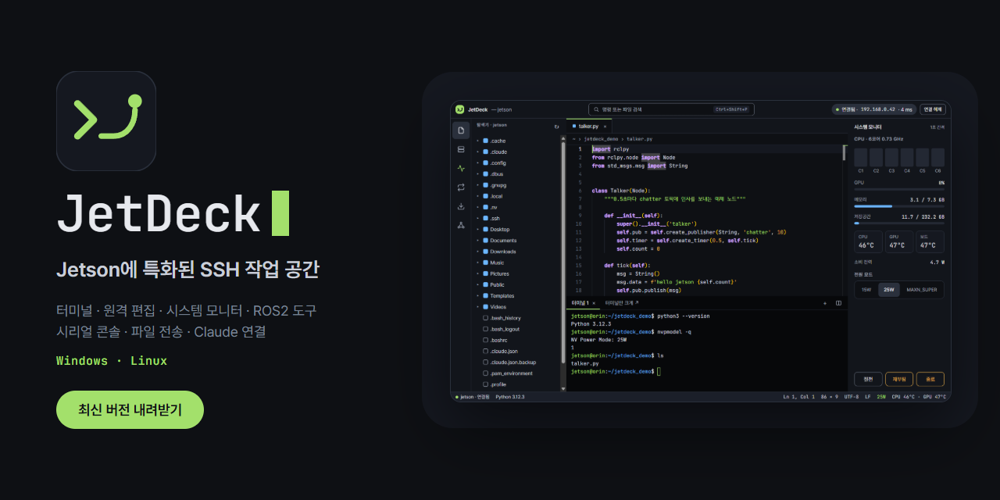</a>

<h3 align="center">젯슨 하나 다루는데 창 다섯 개 띄우지 마세요.</h3>

  터미널 · 원격 편집 · 시스템 모니터 · ROS2 · 파일 전송 · 포트 포워딩 · 시리얼 콘솔 · MCP 연결(Claude 등) 
  <b>NVIDIA Jetson</b>에 특화된, 모든 리눅스 보드를 위한 SSH 작업 공간. 기기에는 SSH 서버 말고 아무것도 설치하지 않아요.

  
  
  

## ✨ 주요 기능

- ⌨️ **터미널** — 탭·분할, 끊기면 자동 재연결
- 📝 **원격 편집** — VS Code와 같은 Monaco 편집기, 기기에 서버 설치 없음, 기기의 저장된 파일과 나란히 비교, 다시 연결하면 열어 둔 탭 복원
- 📊 **시스템 모니터** — CPU 코어·GPU·메모리·온도·전력 그래프, JetPack·CUDA 버전, 전원 모드 전환 (라즈베리 파이 같은 일반 리눅스도 지원)
- ▦ **분할 화면** — 연결을 최대 4개까지 한 화면에 (좌우 나열 / 바둑판), 탭을 끌어다 놓기
- 🔑 **SSH 키 마법사** — 이 PC의 키를 Device에 등록하고 비밀번호 없이 접속
- 🤖 **ROS2 도구** — 토픽 echo·hz 실시간, launch 파일 실행
- 🔧 **시리얼 콘솔** — SSH가 안 될 때의 비상구
- 📁 **파일 전송** · 🔀 **포트 포워딩** — 끌어다 놓기, Jupyter 포트 버튼 한 번
- ✳️ **MCP 연결** — Claude·Cursor·Codex 등 AI가 기기에서 명령 실행·파일 편집 (위험한 명령은 내가 허용해야 실행, 연결되면 버튼에 불이 켜짐)
- 📂 **폴더 전송·명령 스니펫** — 폴더 통째, 동시 4개 전송 / 자주 쓰는 명령 저장
- 🤖 **ROS2 서비스·파라미터·bag** — 호출, 읽기·설정, 재생·녹화
- 🖥 **기기 화면** — VNC 내장 뷰어(noVNC), VNC·RDP 외부 실행, X11(rviz·rqt)을 PC의 X 서버로
- 🐳 **Docker** · 📈 **모니터 기록·프로세스·AI 활동** · 🗂 **여러 기기 대시보드** · 📷 **영상 입력 미리보기**
- 🔨 **개발 작업 흐름** — 시작 화면, 빌드 도구(colcon·catkin_make), 원격 파일 검색·바꾸기, Git 상태
- ⚙️ **서비스·기기 점검** — systemd 시작·정지·journalctl 실시간, 온도·Wi-Fi·SMART·실패한 서비스 알림
- 🧰 **기기 관리** — apt 업데이트·디스크·전원·부팅·로그 보기가 탭 4개로 (바꾸는 작업은 항상 확인창, sudo 비밀번호는 새 터미널에서 직접)
- 🔌 **플러그인 (5.0)** — JSON 팩 파일에 명령·표·버튼·확인창을 적으면 기능이 생겨요. 내 PC에서 코드는 실행되지 않고, 읽기로 증명된 명령만 묻지 않고 실행돼요. 공식 팩(기기 관리·ROS2 패키지·모니터 성능)과 예제 팩 동봉, 만드는 법은 [docs/plugins](docs/plugins/README.md)
- 🔎 **터미널 출력 검색·로그 저장** · 🩺 **진단 정보 저장** — 진단 정보는 기기 이름·주소를 빼고 비밀처럼 보이는 값을 가려서 저장 (터미널 로그는 가리지 않아요)
- 💾 **설정 내보내기·가져오기** · 🔐 **AI 터미널 읽기** — 허용을 물어보고 비밀처럼 보이는 값은 가려서 전달
- 🌐 **영어 화면** — 한국어 ↔ English
- 🆕 **업데이트 내용** — 업데이트하면 바뀐 점을 앱에서 바로 확인 (도움말 옆 버튼으로 다시 보기)
- 🎨 **테마 17종**

  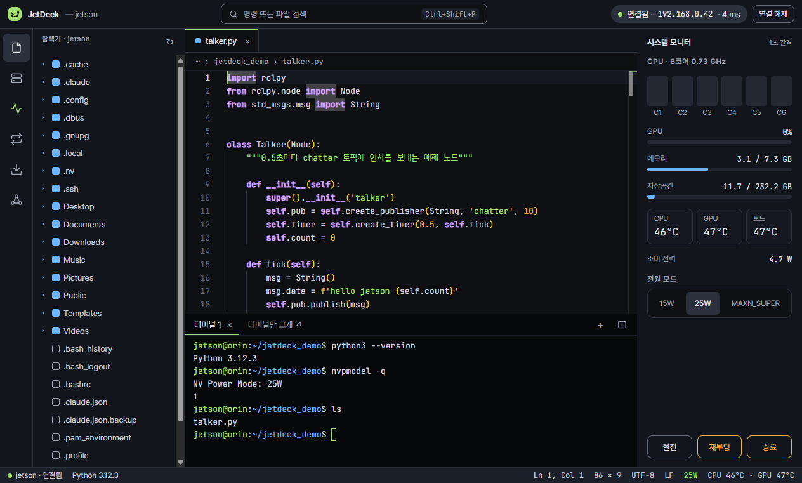

<table>
  <tr>
    <td width="50%">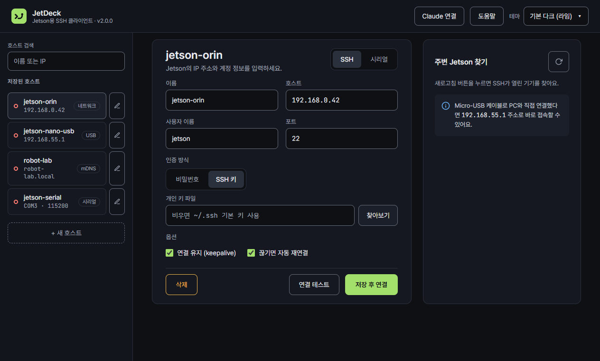 <b>연결 관리</b> · 호스트 저장, 주변 Device 자동 찾기</td>
    <td width="50%">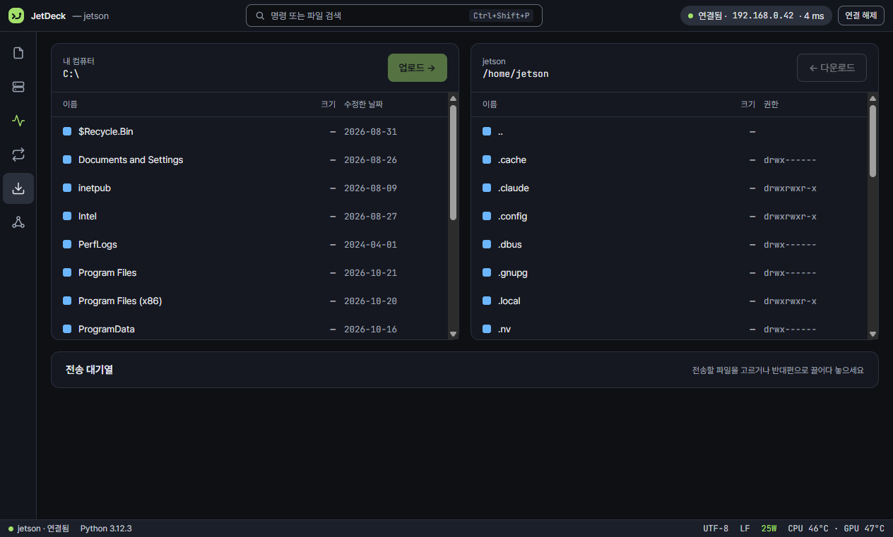 <b>파일 전송</b> · 양쪽 목록, 끌어다 놓기</td>
  </tr>
  <tr>
    <td width="50%">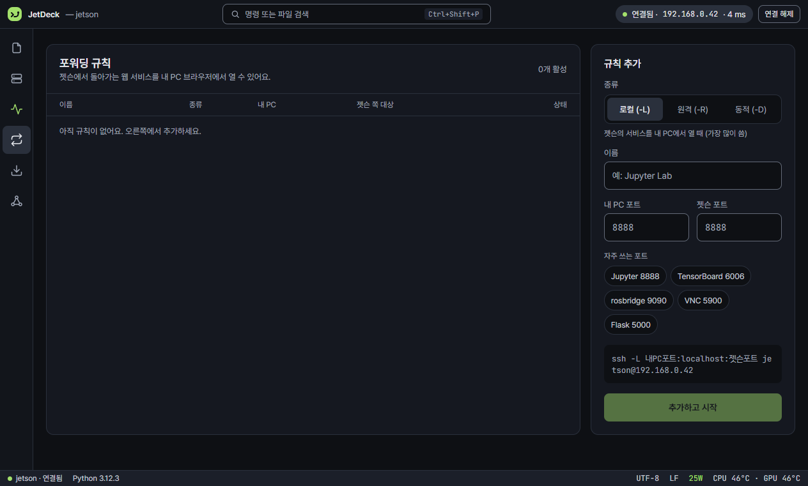 <b>포트 포워딩</b> · 자주 쓰는 포트 한 번에</td>
    <td width="50%">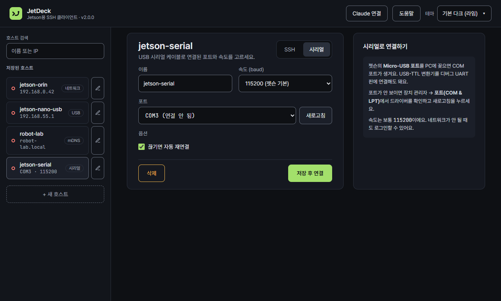 <b>시리얼 콘솔</b> · 포트와 속도만 고르면 끝</td>
  </tr>
  <tr>
    <td width="50%">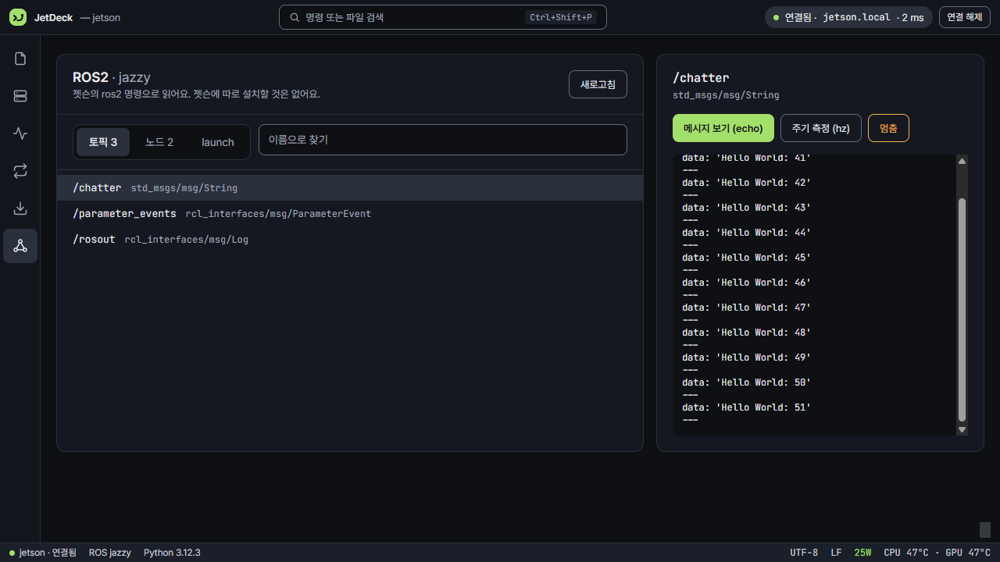 <b>ROS2 도구</b> · 토픽·노드, echo·hz 실시간, launch 실행</td>
    <td width="50%">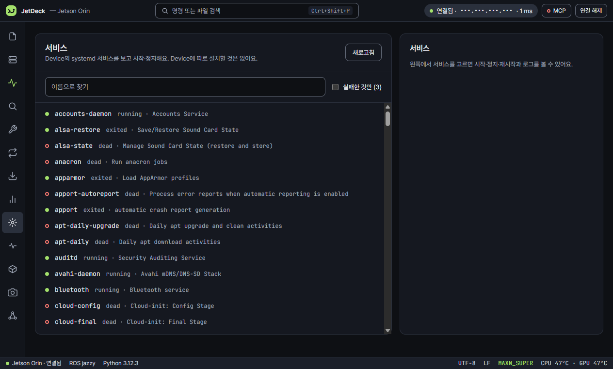 <b>서비스</b> · systemd 시작·정지, 로그 보기</td>
  </tr>
  <tr>
    <td width="50%">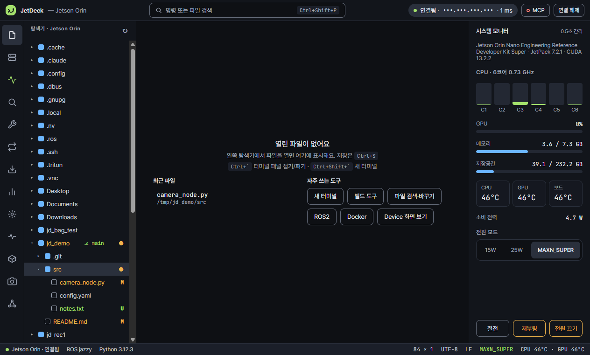 <b>Git 상태</b> · 브랜치와 바뀐 파일 표시</td>
    <td width="50%">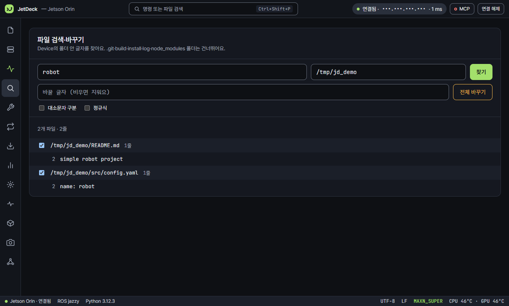 <b>검색·바꾸기</b> · 결과를 누르면 그 줄로 이동</td>
  </tr>
  <tr>
    <td width="50%">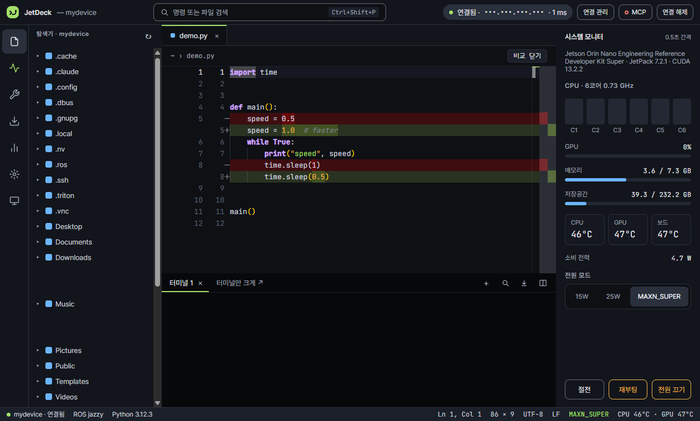 <b>파일 비교</b> · 기기의 저장본과 나란히, 탭은 다시 연결하면 복원</td>
    <td width="50%"></td>
  </tr>
  <tr>
    <td width="50%">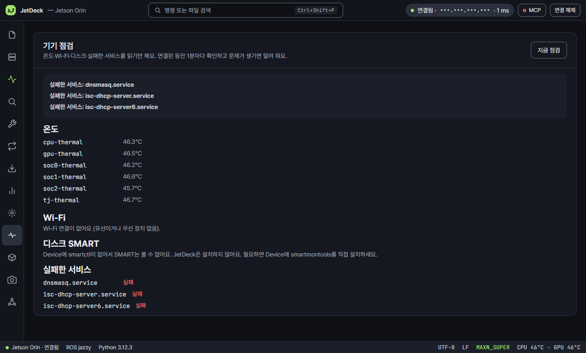 <b>기기 점검</b> · 온도·Wi-Fi·디스크·실패한 서비스</td>
    <td width="50%">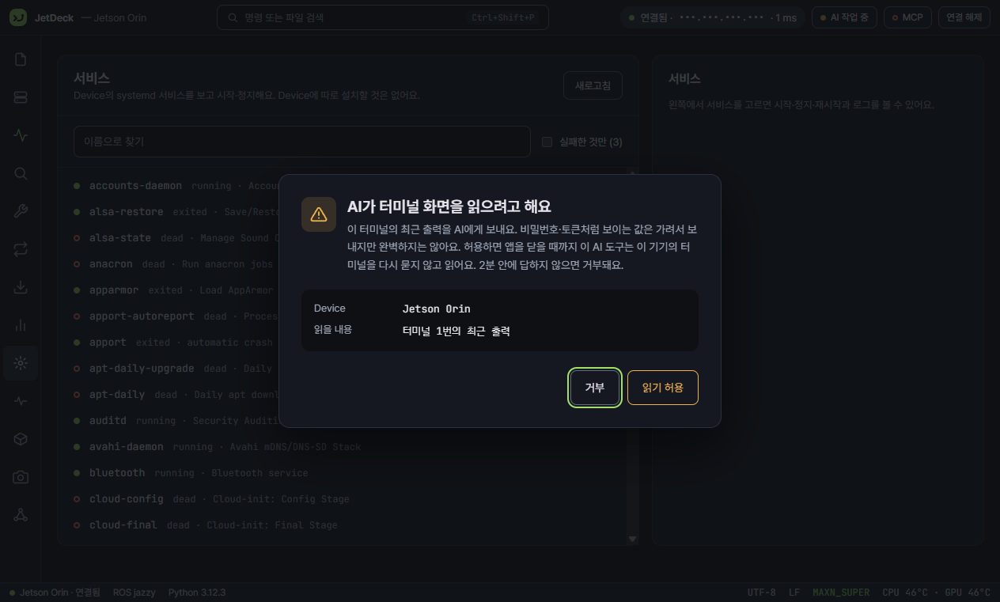 <b>AI 터미널 읽기</b> · 허용을 먼저 묻고 비밀은 가림</td>
  </tr>
  <tr>
    <td width="50%">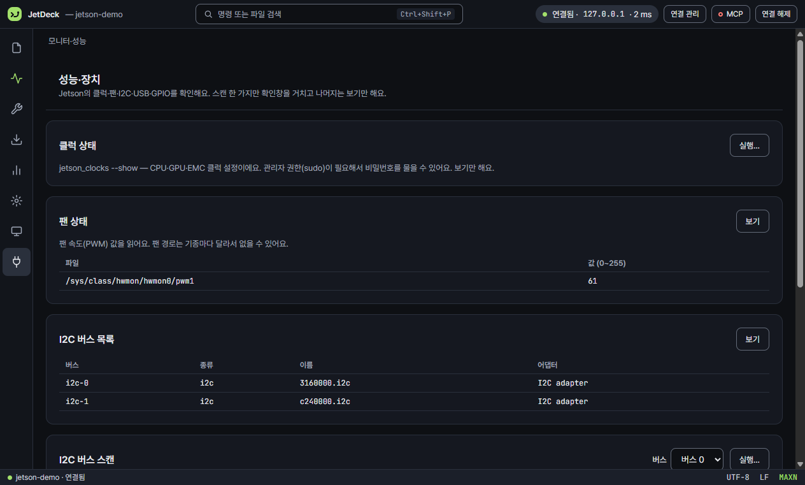 <b>플러그인</b> · 팩 파일로 만든 화면, 읽기만 하는 항목</td>
    <td width="50%">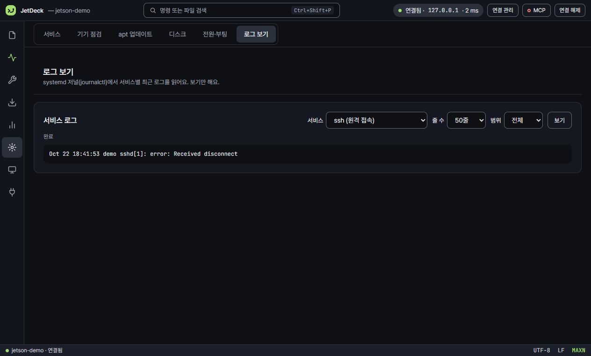 <b>기기 관리</b> · apt·디스크·전원·로그 탭</td>
  </tr>
</table>

더 많은 화면(테마 17종 등)과 자세한 사용법은 **[사이트](https://dawnilove.github.io/JetDeck/)** 에서 볼 수 있어요.

## ⬇ 다운로드

**<https://dawnilove.github.io/JetDeck/>** 에서 받으세요. 설치 방법, 사용법, 화면, 이전 버전도 모두 그곳에 있어요.

- **Windows 10 / 11** — 설치 파일 또는 포터블. "PC 보호" 창이 뜨면 **추가 정보 → 실행**
- **Linux (x64)** — AppImage, `chmod +x` 후 실행
- **Linux (arm64, Jetson 등)** — AppImage, `chmod +x` 후 실행
- **Device 쪽 준비물** — SSH 서버만 켜져 있으면 돼요 (JetPack 기본 상태 그대로 OK)
- **지원 기기** — NVIDIA Jetson은 전체 기능, 라즈베리 파이·우분투 등 일반 리눅스는 터미널·편집·파일 전송·포트 포워딩·모니터(CPU·메모리·온도)

## 🛠 만든 기술

기기에는 아무것도 설치하지 않고 SSH로만 동작해요. Electron 45 · React 19 · TypeScript · ssh2 · xterm.js · Monaco Editor · serialport · noVNC · electron-updater, 빌드는 electron-vite + electron-builder. noVNC는 [MPL-2.0](https://github.com/novnc/noVNC/blob/master/LICENSE.txt) 라이선스예요.

## 🐞 문제가 있나요?

[Issues](https://github.com/Dawnilove/JetDeck/issues)에 증상과 앱 버전을 적어 주세요. 코드를 고쳐서 도와주고 싶다면 [CONTRIBUTING.md](CONTRIBUTING.md)를 읽어 주세요.

## 🧑‍💻 소스 코드와 기여

JetDeck은 오픈 소스예요. 이 저장소에 소스가 있어요.

- **빌드하기**: [BUILDING.md](BUILDING.md)
- **기여하기** (Issues · Pull Request): [CONTRIBUTING.md](CONTRIBUTING.md)
- **보안 제보**: [SECURITY.md](SECURITY.md)

## 📄 라이선스

코드는 [Apache License 2.0](LICENSE)이에요. Copyright © 2026 Dawnilove.
이름 "JetDeck"·로고·마스코트는 코드와 별도예요 → [TRADEMARKS.md](TRADEMARKS.md).
제3자 구성요소(noVNC MPL-2.0, 글꼴 OFL 등)는 [NOTICE](NOTICE)에 있어요.
이전 버전(v4.3.0 이하)의 설치 파일도 같은 조건으로 사용·재배포할 수 있어요.
