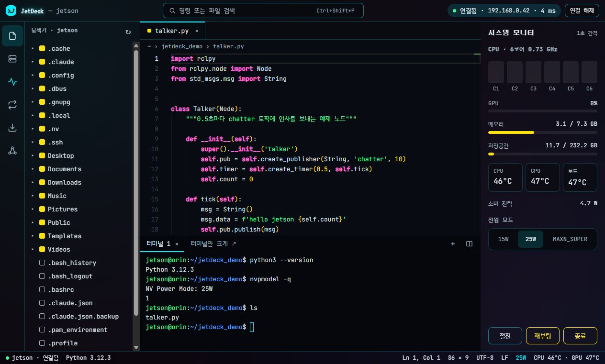
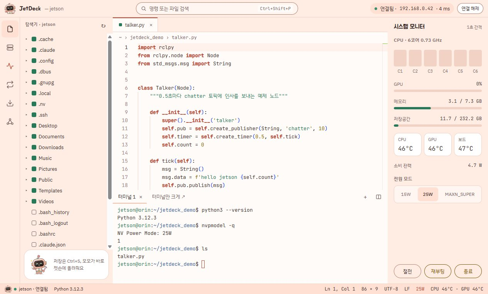
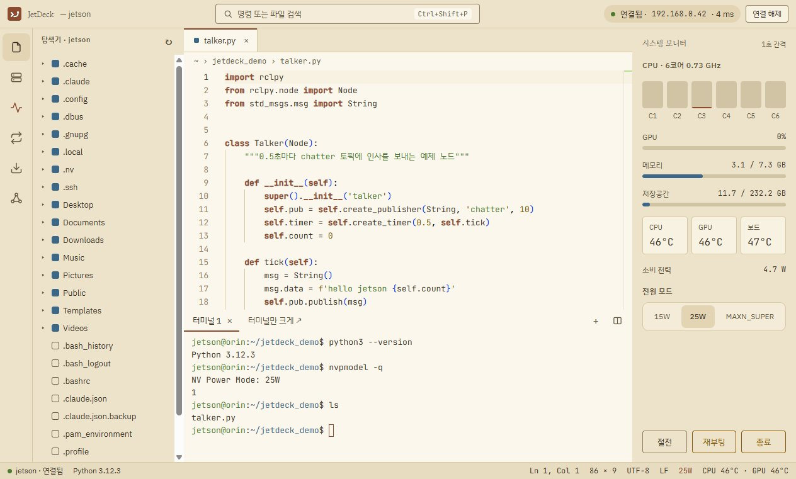

# JetDeck 2.0.0 — ROS2 · 시리얼 · Linux · 테마 17종

  

> **젯슨 작업의 마지막 퍼즐까지.** ROS2 토픽을 실시간으로 보고, 네트워크가 죽어도 시리얼로 살리고, Linux에서도 쓰고, 기분 따라 17가지 테마로.
> 그런데 설치 파일은 **1.0.1보다 약 25 MB(18%) 가벼워졌어요.**

1.0.x를 쓰고 있다면 앱을 켤 때 **자동으로 받아서** 화면 위쪽에 알려 줘요. **다시 시작해서 업데이트**를 누르면 끝 (이번 버전부터는 설치 창 없이 조용히 업데이트돼요).
저장된 호스트·비밀번호·포워딩 규칙은 그대로예요.

---

## ✨ 새 기능

### 🤖 ROS2 도구

왼쪽 활동 바의 **ROS2** 버튼 (또는 `Ctrl+Shift+P` → "ROS2"). 젯슨의 `ros2` 명령을 SSH로 실행해 보여 줘요 — 젯슨에 따로 설치할 것 없음.

| | |
|---|---|
| **토픽** | 목록·메시지 타입, 발행·구독 노드(`info`) |
| **메시지 보기 (echo)** · **주기 측정 (hz)** | 실시간 표시. 멈추거나 화면을 닫으면 젯슨 쪽 명령도 같이 끝나요 |
| **노드** | 목록과 연결된 토픽·서비스 |
| **launch** | 내 워크스페이스와 설치된 패키지의 launch 파일을 찾아, 확인 후 새 터미널 탭에서 실행 |

### 🔧 시리얼 콘솔

네트워크 설정이 꼬여 SSH로 못 들어갈 때 USB 시리얼로 바로 접속.

- **새 연결 → 시리얼**에서 포트(`COM3`, `/dev/ttyUSB0`)와 속도(기본 **115200**)만
- 포트가 꽂혀 있으면 호스트 목록에 초록 점
- 케이블이 빠졌다 다시 꽂히면 **자동 재연결**
- 다른 프로그램이 쓰는 중 · 권한 없음 · 포트 없음 → 이유와 해결 방법을 알려 줘요

 

### 🐧 Linux 버전 (AppImage, x64)

- `JetDeck-2.0.0-x86_64.AppImage` 하나로 실행, **자동 업데이트**도 Windows와 같아요
- 비밀번호는 키링(GNOME Keyring 등)으로 암호화. 키링이 없으면 안전하게 저장할 수 없어서 **저장하지 않고 알려 줘요**

### 🎨 테마 17종 + 새 테마 메뉴

  
  
  

| 묶음 | 테마 |
|---|---|
| **에센셜** | 기본 다크(라임) · 라이트(베이지·올리브) · 다크(모노 블랙) · 솜사탕 — 입력 테두리·경고 글자·줄 번호 대비를 높이고 편집기 팝업 색까지 맞춤 |
| **컬러 무드** | 노을 · 숲 · 딥 오션 · 종이(세피아) · 레트로 터미널 · 라벤더 · 고대비 |
| **네온 사인** | 네온 시안 · 네온 그린 · 네온 마젠타 — 그라데이션 배경, 유리 패널, *연결 중일 때만* 테두리 발광 |
| **마스코트** | 모모의 꽃잎 공방 · 볼트의 한밤 격납고 · 두두의 터널 공사장 — 연결 상태에 따라 표정과 한마디가 바뀌어요 (**마스코트 숨기기** 가능) |

- 테마 메뉴는 묶음별로 **접혀 있어서** 필요한 것만 펼쳐 봐요
- 모든 테마의 글자·터미널 색 대비 **4.5:1 이상**, 터미널·편집기는 항상 불투명

## ⚡ 더 빠르고 가볍게

| | 1.0.1 | 2.0.0 |
|---|---|---|
| 설치 파일 (Windows) | 139 MB | **114 MB** |
| 앱 첫 화면까지 | 0.52초 | **0.18초** |
| 시작 직후 화면 메모리 | 18 MB | **10 MB** |

- 편집기는 **파일을 처음 열 때** 불러와요 → 첫 화면이 3배 빨라지고, 편집기를 안 쓰면 메모리를 아껴요
- 젯슨 여러 대를 열어 둘 때 **안 보이는 탭은 화면을 다시 그리지 않아요** (값은 계속 받아 두고, 돌아오면 바로 최신값)
- 쓰지 않는 글꼴 굵기·옛 글꼴 형식·언어팩·다른 OS용 파일을 뺐어요 — 새 글꼴 3종이 들어갔는데도 더 작아요

> 크기는 Windows 파일 속성에 나오는 값, 시간·메모리는 같은 PC에서 잰 값이에요 (PC마다 달라요).

## 🛠 그 밖에

- 연결 관리 화면을 다듬었어요 — 연결 종류(SSH·시리얼) 버튼, 시리얼 안내 카드, 키보드로 고르는 버튼
- `Esc`로 ROS2·파일 전송·포트 포워딩 화면 닫기
- 새 아이콘
- 비밀번호 로그인을 막아 둔 기기에 접속하면 해결 방법을 화면에 바로 보여 줘요

## ⬇ 내려받기

| 파일 | 크기 | 용도 |
|---|---|---|
| `JetDeck-Setup-2.0.0.exe` | 114 MB | **Windows 설치판 (추천)** — 바로가기·자동 업데이트 |
| `JetDeck-2.0.0-portable.exe` | 114 MB | Windows 설치 없이 실행 (자동 업데이트 없음) |
| `JetDeck-2.0.0-x86_64.AppImage` | 109 MB | Linux x64 (자동 업데이트) |

> **Windows**: 처음 실행 때 "Windows의 PC 보호" 창이 뜨면 **추가 정보 → 실행** (코드 서명 인증서가 아직 없어요)
> **Linux**: `chmod +x JetDeck-2.0.0-x86_64.AppImage` 후 실행. 안 열리면 `sudo apt install libfuse2` (24.04는 `libfuse2t64`)

## 알아 두세요

- ROS2 도구는 젯슨에 ROS2(`ros2` 명령)가 있어야 해요. ROS1(catkin)은 지원하지 않아요
- 시리얼 콘솔은 터미널 하나만 열려요. 파일·모니터·포워딩·ROS2는 SSH 연결에서만 돼요
- Linux판은 x64만 있어요 (젯슨에서 직접 돌리는 arm64판은 2.1에서)

다음 버전: [2.0.1](v2.0.1.md) · 이전 버전: [1.0.1](v1.0.1.md) · [1.0.0](v1.0.0.md)
